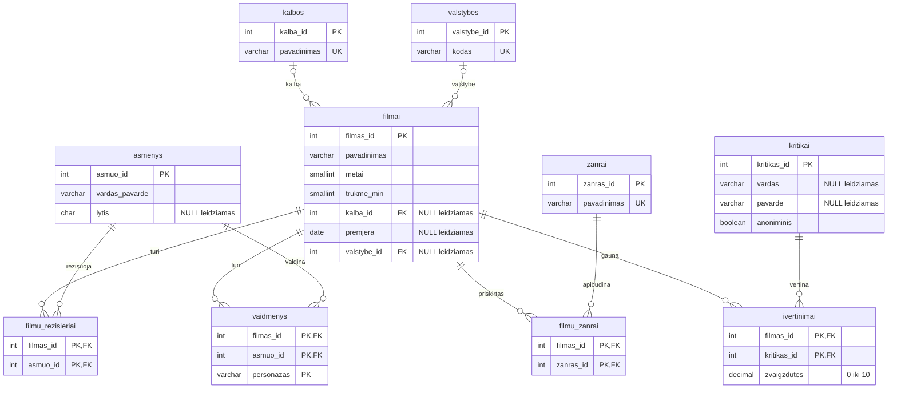

# FILMUKAI – duomenų bazė

Duomenų bazės užduotis pagal pateiktą `data.xlsx` failą. Sudaryta schema, 10 tarpusavyje susietų lentelių ir 22 SQL užklausos.

## Failai

- **Importas.sql** – lentelės, ryšiai ir duomenys. Importavus sukuriamas ir filmų įvertinimų vidurkių rodinys.
- **Užklausos.sql** – visos 22 užduoties užklausos, sunumeruotos nuo 1 iki 22.
- **Schema.svg** – duomenų bazės diagrama.
- **Schema.mmd** – tos pačios diagramos Mermaid aprašymas.
- **Rezultatai.md** – užklausų atsakymai pagal pateiktus duomenis.

## Kaip paleisti

1. Atidaryk **phpMyAdmin** ir susikurk tuščią duomenų bazę, pvz., `filmukai`.
2. Pasirink šią bazę, eik į **Importuoti** ir įkelk `Importas.sql`.
3. Kai importas baigsis, turi būti **10 lentelių** ir rodinys `filmu_vidurkiai`.
4. Atidaryk **SQL** ir vykdyk užklausas iš `Užklausos.sql` (atskirais numeruotais blokais).

Duomenų patikrai: `filmai` lentelėje yra **28 filmai**, o `ivertinimai` – **36 įvertinimai**.

**Pastaba.** Užduoties pradiniai duomenys palikti tokie, kokie pateikti „Excel“ faile. Jei ten aktorius, filmas ar personažas neatitinka tikrovės, SQL atsakymas vis tiek remiasi pateiktais duomenimis.

## Duomenų bazės ryšiai

